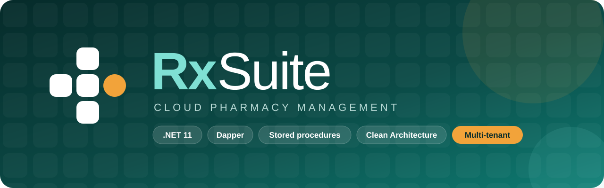
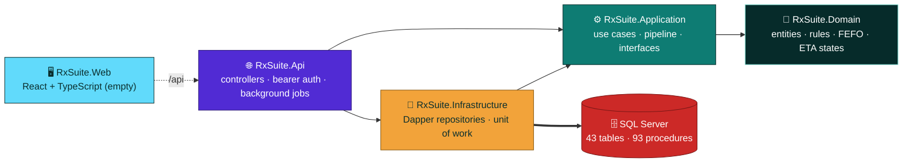
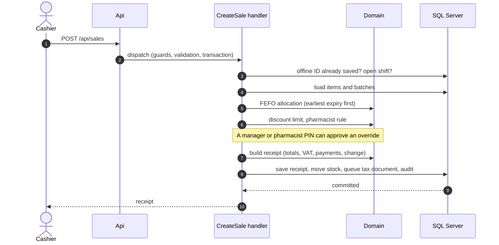
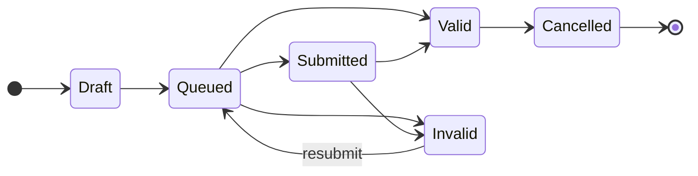
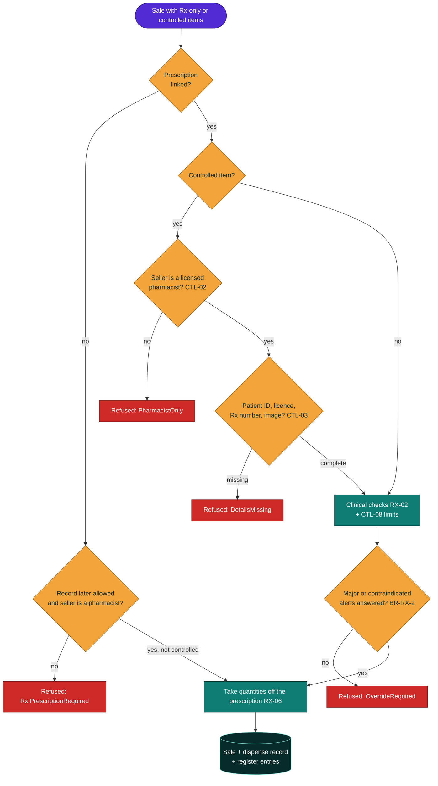

<p align="center">
  
</p>

<p align="center">
  
  
  
  
  
</p>

<p align="center">
  
  
  
  
  
  
</p>

<p align="center">
  <a href="#-what-is-rxsuite">About</a> ·
  <a href="#-architecture">Architecture</a> ·
  <a href="#-how-a-request-travels">Request flow</a> ·
  <a href="#-design-patterns">Patterns</a> ·
  <a href="#-run-it">Run it</a> ·
  <a href="#-api">API</a> ·
  <a href="#-brd-coverage">BRD coverage</a> ·
  <a href="#-verification-status">Status</a>
</p>

---

## 💊 What is RxSuite

RxSuite is a cloud, multi-tenant pharmacy management platform for Egyptian pharmacies. This
repository holds its **back end**, built from **RxSuite BRD v1.1**, plus an empty React project for
the front end.

This build is the **core slice** the BRD's delivery plan puts first (months 1-6), plus
**prescriptions with clinical checks (8.6)** and the **digital controlled-drugs register (8.7)**. The section
[BRD coverage](#-brd-coverage) lists exactly what is built, what is partial and what is not started.

<table>
  <tr>
    <td align="center" width="16%">🏢<br><b>Platform</b><br><sub>Plans, sign-up, subscriptions, branches</sub></td>
    <td align="center" width="16%">🔐<br><b>Identity</b><br><sub>Roles, permissions, manager PIN, audit log</sub></td>
    <td align="center" width="16%">📦<br><b>Inventory</b><br><sub>Batches, FEFO, expiry, recalls</sub></td>
    <td align="center" width="16%">🚚<br><b>Purchasing</b><br><sub>Suppliers, orders, goods receipts</sub></td>
    <td align="center" width="16%">🧾<br><b>POS</b><br><sub>Shifts, sales, split payment, returns</sub></td>
    <td align="center" width="16%">🏛️<br><b>ETA</b><br><sub>Tax document queue and tracking</sub></td>
  </tr>
  <tr>
    <td align="center" colspan="3">🩺<br><b>Prescriptions</b><br><sub>Drug database, allergy and interaction alerts, partial dispensing and refills, encrypted images, labels</sub></td>
    <td align="center" colspan="3">🔐<br><b>Controlled drugs</b><br><sub>Append-only register with running balance, signed counts, mismatch alerts, inspector export</sub></td>
  </tr>
</table>

| | |
|---|---|
| 🧱 **Stack** | .NET 11, ASP.NET Core Web API, SQL Server |
| 🗄️ **Data access** | Dapper with **stored procedures only**: 93 procedures, no SQL text in C# |
| 🏗️ **Design** | Clean Architecture, SOLID, twelve named design patterns |
| 🏬 **Tenancy** | Every table carries `TenantId`; the repositories add it to every call |
| 📝 **Code style** | Named `#region` blocks, XML summaries, comments that cite the BRD rule |

---

## 🏗️ Architecture



Dependencies point inward only. Domain references nothing. Application declares the interfaces it
needs (`IItemRepository`, `IUnitOfWork`, `ICurrentUser`, `IEtaGateway`); Infrastructure and Api
implement them. Api is the only place that knows every layer, and only to wire them together.

### Solution structure

```
RxSuite.sln
├─ Directory.Build.props        target framework, nullable, warnings as errors (all projects)
├─ Directory.Packages.props     all NuGet versions in one place
├─ database/
│  ├─ 001_Schema.sql            43 tables, keys, constraints, immutable audit and register triggers
│  ├─ 002_Seed.sql              plans, roles, permission matrix (BRD section 9), SAMPLE drug database
│  └─ StoredProcedures/         one file per module, one region per procedure
├─ docs/assets/                 logo and banner
└─ src/
   ├─ RxSuite.Domain            entities, value rules, FEFO allocator, ETA status flow, BusinessRules
   ├─ RxSuite.Application       use cases (commands/queries), pipeline, repository interfaces
   ├─ RxSuite.Infrastructure    Dapper repositories, unit of work, hashing, clock
   ├─ RxSuite.Api               controllers, bearer-token auth, background jobs, composition root
   └─ RxSuite.Web               React + TypeScript (Vite) template, empty
```

---

## 🔁 How a request travels

```mermaid
flowchart LR
    C["Controller"]:::api --> D["IDispatcher"]:::app
    D --> G1["PermissionGuard"]:::guard
    G1 --> G2["ActiveUserGuard"]:::guard
    G2 --> G3["TenantWriteGuard"]:::guard
    G3 --> V["Validators"]:::app
    V --> T["Transaction"]:::infra
    T --> H["Handler"]:::app
    H --> R["Repositories"]:::infra
    R --> SP[("Stored procedures")]:::db

    classDef api fill:#512BD4,stroke:#2E1A7A,color:#FFFFFF
    classDef app fill:#0E7C73,stroke:#062B2A,color:#FFFFFF
    classDef guard fill:#062B2A,stroke:#7FE0D4,color:#FFFFFF
    classDef infra fill:#F2A33A,stroke:#8A5A12,color:#0B2F2E
    classDef db fill:#CC2927,stroke:#7A1716,color:#FFFFFF
```



| Guard | What it stops |
|---|---|
| 🛡️ `PermissionGuard` | A caller who is not logged in or lacks the permission the request asks for |
| 🚫 `ActiveUserGuard` | A disabled user, on the very next request (AC-USR-2) |
| 🔒 `TenantWriteGuard` | Any change by a read-only tenant; reads still work (BR-SUB-4) |

Every command runs in one database transaction: it commits on success and rolls back on a failure
result or an exception.

### A sale, step by step



### ETA document states

Only these arrows are allowed (`Domain/Tax/EtaDocument.cs`).



### Dispensing a prescription (BRD 8.6, 8.7)

Everything below is decided before anything is saved, and saved in the sale's one transaction.



| Check (RX-02) | Severity | Example |
|---|---|---|
| Allergy to the ingredient or its class | Contraindicated | Penicillin allergy + amoxicillin (AC-RX-1) |
| Drug–drug interaction, new items or current medicines | From the database | Warfarin the patient already takes + aspirin |
| Duplicate therapy | Major (same ingredient), moderate (same class) | Two brands of amoxicillin |
| Age | Major | Aspirin under 16 |
| Maximum daily dose | Major | 2 × 400 mg ibuprofen 4 times a day |
| Controlled limits (CTL-08) | Major | Over 20 units per prescription or 30 per patient per month |

Major and contraindicated alerts need an override with a reason; the alerts shown and the reasons
are stored with the dispense and in the audit trail.

### The controlled register

| Movement | Entry | Written by |
|---|---|---|
| Goods received | Purchase, in | `ReceiveGoods`, pharmacist only |
| Sold on a prescription | Dispense, out, with patient ID, prescriber licence, Rx number, date and image | `CreateSale`, pharmacist at the till |
| Expired or damaged | Destruction, out | `AdjustStock`, pharmacist only |
| Count correction | Adjustment, in or out | `AdjustStock`, pharmacist only |
| Wrong details | Correction pointing to the original entry | `CorrectRegisterEntry` |

The running balance is worked out by the stored procedure under a lock, so two tills never start
from the same balance, and a database trigger refuses any update or delete, Owner included
(BR-CTL-2). Signed balance checks are immutable too.

---

## 🧩 Design patterns

| Pattern | Where | Why |
|---|---|---|
| 📮 Mediator | `Application/Pipeline/Pipeline.cs` (`Dispatcher`) | Controllers and jobs never reference a handler |
| ⛓️ Chain of Responsibility | `IRequestGuard` and its three guards | A new cross-cutting rule is a new class |
| 🎁 Decorator | `RequestPipeline<,>` | Guards, validation and the transaction wrap every handler |
| ↔️ CQRS (light) | `ICommand<T>` / `IQuery<T>`, `Application/Features` | One small handler per use case; queries return DTOs |
| 🗃️ Repository | `Application/Abstractions/Persistence.cs`, `Infrastructure/Persistence/Repositories` | Use cases never see SQL |
| 🧾 Unit of Work | `Infrastructure/Persistence/Connection/DbSession.cs` | All procedures of a command share one transaction |
| 📐 Template | `StoredProcedureRepository`, `PeriodicJob` | One way to call a procedure; one loop for background jobs |
| 🏭 Factory | `SqlConnectionFactory` | One class knows the database vendor |
| 🔌 Adapter | `CurrentUser`, `SecretHasher`, `UnconfiguredEtaGateway` | HTTP, hashing and ETA sit behind Application interfaces |
| 🚦 State | `Domain/Tax/EtaDocument.cs` | Only the status arrows of BRD Figure 15 are allowed |
| ✅ Result | `Domain/Common/Result.cs` | Expected failures without exceptions |
| ⚙️ Options | `Domain/Rules/BusinessRules.cs`, `appsettings.json` | The BRD's numbers are configuration |

### SOLID

| | Principle | In this code |
|---|---|---|
| **S** | Single responsibility | One handler per use case; controllers only translate HTTP; entities own their rules |
| **O** | Open/closed | A new use case is a new file in `Features` (found by scanning); a new guard is a new class |
| **L** | Liskov substitution | Every repository, guard and gateway can replace its interface without the caller noticing |
| **I** | Interface segregation | Small interfaces per aggregate (`IShiftRepository`, `ISaleRepository`...), `ICurrentUser`, `IClock` |
| **D** | Dependency inversion | Application and Domain depend on abstractions; Infrastructure and Api depend on them |

### Code conventions

Every class is split into named `#region` blocks, every type has an XML summary saying what it is and
why, and comments cite the BRD requirement they implement (`POS-04`, `BR-INV-3`, `AC-PUR-2`...).
A use case lives in one file with the regions `Command`/`Query`, `Validator`, `Handler`.

---

## 🚀 Run it

**You need:** .NET 11 SDK, SQL Server, Node.js (for the front end only).

1. **Database.** Create a database named `RxSuite`; run `database/001_Schema.sql`,
   `database/002_Seed.sql`, then every file in `database/StoredProcedures` in order.
2. **Prices.** Set plan prices in `dbo.Plans` (the BRD leaves them "TBC"; they are seeded as 0).
3. **Settings.** Set `ConnectionStrings:Default` (and `Webhooks:PaymentSecret`) in
   `src/RxSuite.Api/appsettings.json`, and the image key outside source control:

   ```bash
   dotnet user-secrets --project src/RxSuite.Api init
   dotnet user-secrets --project src/RxSuite.Api set "PrescriptionImages:Key" "$(openssl rand -base64 32)"
   ```
4. **API.**

   ```bash
   dotnet run --project src/RxSuite.Api
   ```

   It listens on https://localhost:7080. Walk through `src/RxSuite.Api/RxSuite.Api.http`: sign up,
   log in, create an item, receive goods, open a shift, sell, return; then steps 14-27 for a
   prescription with an allergy alert, and the controlled register. OpenAPI: `/openapi/v1.json`.
5. **Front end.**

   ```bash
   cd src/RxSuite.Web
   npm install
   npm run dev
   ```

   It runs on http://localhost:5173 and proxies `/api` to the API.

---

## 🌐 API

| Area | Endpoints |
|---|---|
| 🌍 Public | `GET /api/public/plans`, `POST /api/public/sign-up`, `POST /api/auth/login` |
| 🏢 Platform | `GET /api/subscription`, `GET/POST /api/branches`, `POST /api/webhooks/subscription-payment` |
| 👥 Users | `GET/POST /api/users`, `POST /api/users/{id}/disable`, `GET /api/audit-log` |
| 💊 Items | `POST /api/items`, `PUT /api/items/{id}/price`, `GET /api/items/search` |
| 📦 Stock | `GET /api/stock/card`, `GET /api/stock/alerts`, `POST /api/stock/batches/{id}/adjust`, `POST /api/stock/recalls` |
| 🚚 Purchasing | `GET/POST /api/suppliers`, `GET/POST /api/purchase-orders`, `POST /api/purchase-orders/{id}/approve`, `POST /api/goods-receipts` |
| 🧾 POS | `POST /api/shifts`, `GET /api/shifts/{id}`, `POST /api/shifts/{id}/cash-movements`, `POST /api/shifts/{id}/close`, `POST /api/sales`, `GET /api/sales/{id}`, `POST /api/sales/{id}/returns` |
| 🏛️ ETA | `GET /api/eta-documents`, `POST /api/eta-documents/{id}/resubmit` |
| 🩺 Drugs and checks | `GET /api/drugs`, `POST /api/clinical-checks` |
| 🧑‍⚕️ Patients | `GET/POST /api/patients`, `GET /api/patients/{id}`, `POST /api/patients/{id}/allergies`, `GET/POST /api/prescribers` |
| 📄 Prescriptions | `POST /api/prescriptions`, `GET /api/prescriptions/{id}`, `GET /api/prescriptions/open`, `POST /api/prescriptions/{id}/cancel`, `POST /api/prescriptions/{id}/images`, `GET /api/prescriptions/{id}/images/{imageId}`, `GET /api/sales/{id}/labels` |
| 🔐 Controlled register | `GET /api/controlled-register`, `GET /api/controlled-register/export`, `GET /api/controlled-register/monthly-summary`, `GET /api/controlled-register/status`, `POST /api/controlled-register/balance-checks`, `POST /api/controlled-register/{entryId}/corrections` |

⏱️ **Background jobs** (`Api/BackgroundJobs`): nightly subscription status refresh and quarantine of
expired batches; ETA queue submission every 30 seconds.

---

## 📋 BRD coverage

| | Module | Status |
|---|---|---|
| 8.1 | Subscription | 🟡 Core built |
| 8.2 | Users & audit | 🟡 Core built |
| 8.3 | POS | 🟡 Core built |
| 8.4 | Inventory | 🟡 Core built |
| 8.5 | Purchasing | 🟡 Core built |
| 8.9 | ETA e-invoicing | 🟡 Queue and tracking built, real adapter missing |
| 8.6 | Prescriptions | 🟡 Core built |
| 8.7 | Controlled drugs | 🟡 Core built |
| 8.8 | Multi-branch transfers | ⚪ Not started |
| 8.10 | Insurance | ⚪ Not started |
| 8.11 | Customers & loyalty | ⚪ Not started |
| 8.12 | Online orders | ⚪ Not started |
| 8.13 | Hospital | ⚪ Not started |
| 8.14 | Reports | ⚪ Not started |
| 8.15 | AI | ⚪ Not started |
| 8.16 | Integrations | ⚪ Not started |

<details open>
<summary><b>✅ Built</b> (rules enforced and checked)</summary>

<br>

| Module | Requirements |
|---|---|
| 8.1 Subscription | SUB-03, SUB-04, SUB-12; BR-SUB-1..4; AC-SUB-2 |
| 8.2 Users & audit | USR-01, USR-03, USR-04, USR-12; BR-USR-2, 3, 4; AC-USR-1, 2, 3 |
| 8.3 POS | POS-02, 03, 04, 05, 07, 16; BR-POS-1..6; AC-POS-2, 3, 4 |
| 8.4 Inventory | INV-08, INV-09, INV-12; BR-INV-1..3; AC-INV-1 |
| 8.5 Purchasing | PUR-03, PUR-06, PUR-07; BR-PUR-1..4; AC-PUR-1, 2, 3 |
| 8.9 ETA | ACC-04, ACC-06; BR-ACC-2, 3; AC-ACC-2 |
| 8.6 Prescriptions | RX-02, RX-03, RX-04, RX-05, RX-06, RX-07, RX-08, RX-10; BR-RX-1, 2, 3; AC-RX-1, 2 |
| 8.7 Controlled drugs | CTL-01, CTL-02, CTL-03, CTL-04, CTL-05, CTL-08; BR-CTL-2; AC-CTL-1 |

</details>

<details>
<summary><b>🟡 Partial</b></summary>

<br>

- SUB-01 sign-up without mobile OTP; SUB-06 payment is recorded from a webhook, no Paymob/Fawry
  integration; SUB-11 billing data without invoice history.
- USR-02 roles and permissions are tables, no custom-role editor; a user has one role; USR-07 manager
  PIN covers discount, shift variance and stock adjustment; USR-10 licence stored and enforced, no
  30-day warning; USR-11 covers logins, price changes, discount overrides, returns, adjustments,
  recalls, user changes.
- POS-01 search without typo tolerance; POS-10 cash, card, wallet, Fawry, InstaPay and split, without
  insurance, credit, loyalty or store credit; POS-13 the tax document is created and queued;
  POS-14 returns need the original receipt, non-resaleable items are refunded but not moved to a
  quarantine stock record; POS-15 server side only (idempotent offline ID).
- INV-01/02 local items with barcodes and box/strip/unit; INV-04 no storage location; INV-05 cost is
  kept per batch (weighted average when a batch is topped up); INV-06 reorder level per item, not per
  branch; INV-07 one near-expiry threshold.
- PUR-01 basic supplier record; PUR-04 one approval level; PUR-10 running balance only.
- ACC-03/05/07 queue, retry, error list and resubmit work, but **the real ETA adapter (signing and
  the ETA API) is not written**: `UnconfiguredEtaGateway` leaves every document queued.
- RX-01 the central drug database tables and procedures exist, but **only a small SAMPLE is seeded**;
  the real data must come from a licensed source. RX-11 the central monthly update job and the
  tenants' local notes are not built.
- RX-05 images come from an upload (scanner, webcam, phone); the WhatsApp order source comes with 8.12.
- RX-09 directory search sorted by how often each doctor prescribes; the most-prescribed-items report is not built.
- CTL-06 the signed count is built; the locked-cabinet storage location is not (INV-04).
- CTL-07 the register exports as CSV with Arabic and English headers; **the official inspector layout
  must be confirmed** and then matched (or printed as PDF).
- BR-CTL-1 controlled sales need the logged-in pharmacist and the patient's national ID on the server;
  the offline terminal itself is not built.

</details>

<details>
<summary><b>⚪ Not started</b></summary>

<br>

SUB-02, 05, 07-10, 13-18 · USR-05, 06, 08, 09, 13, 14 · POS-06 (always blocks), 08, 09, 11, 12,
17-21 · INV-03, 10, 11, 13-16 · PUR-02, 05, 08, 09, 11-13 · ACC-01, 02, 08-13 · and the whole of
8.8 Multi-branch transfers, 8.10 Insurance,
8.11 Customers & loyalty, 8.12 Online orders, 8.13 Hospital, 8.14 Reports, 8.15 AI,
8.16 Integrations.

</details>

---

## 🧭 Decisions and assumptions to confirm

1. **Selling prices include VAT**; the VAT part is taken out of the line total (`SaleLine.Create`).
2. **Rx-only and controlled items** need a licensed pharmacist on the sale (the cashier, or another
   user's PIN). The full prescription flow of BRD 8.6 is not built.
3. **Access tokens** are ASP.NET Core bearer tokens (8 hours, no refresh endpoint yet). They are
   protected with Data Protection keys: persist and share the key ring when running more than one
   instance. Switching to JWT only touches `Program.cs` and `AuthController`.
4. **Business rules are per installation** (`appsettings.json`), while the BRD wants several per tenant.
5. **Payment webhook** is protected by a shared-secret header; replace it with the gateway's own
   signature check when integrating Paymob or Fawry.
6. **Controlled medicines are not returned at the counter.** The BRD gives the register no
   "customer return" entry; a pharmacist records such stock with an adjustment instead.
7. **Allergies are codes** from the drug database: an ingredient (`AMOXICILLIN`) or a class
   (`PENICILLINS`). The screen should offer them from a list rather than free text.
8. **Prescription images** are encrypted with AES-GCM in files under `PrescriptionImages:Path`.
   The key (`PrescriptionImages:Key`, 32 bytes in Base64) must be kept out of source control and
   backed up: without it the images cannot be read. Every view and every register export is audited.
9. **Pharmacists now hold `stock.adjust`** in the seed, because only a pharmacist may adjust a
   controlled item.

---

## 🔬 Verification status

> [!WARNING]
> This code has **not** been built on .NET 11 with the real NuGet packages, and the SQL scripts have
> **not** been executed on SQL Server. Do both before relying on it.

| Check | Result |
|---|---|
| Compile | ✅ Warning-free on the .NET 10 SDK with stand-ins for Dapper and Microsoft.Data.SqlClient (the .NET 11 SDK and NuGet were not reachable where this was built) |
| Behaviour | ✅ 158 checks of the use cases and domain rules pass against in-memory repositories |
| HTTP | ✅ Run end to end with in-memory repositories: sign-up, login, token, permissions, sale, return, shift report, webhook, background jobs |
| SQL syntax | ✅ Scripts pass a T-SQL syntax parser; every procedure name and parameter matches its C# call |
| Build on .NET 11 | ❌ Not done |
| SQL on a real server | ❌ Not done |

---

<p align="center">
  <br>
  <sub>Built by <b>Muhammed Ragab Hussein</b> · RxSuite BRD v1.1</sub>
</p>
